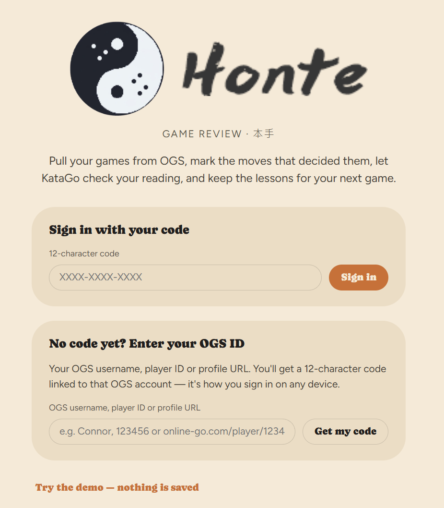
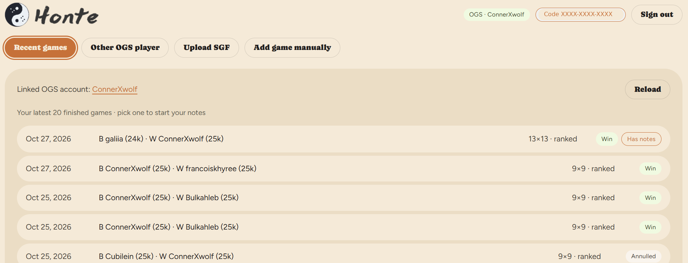
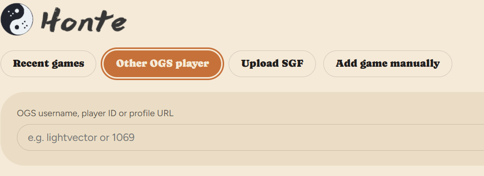
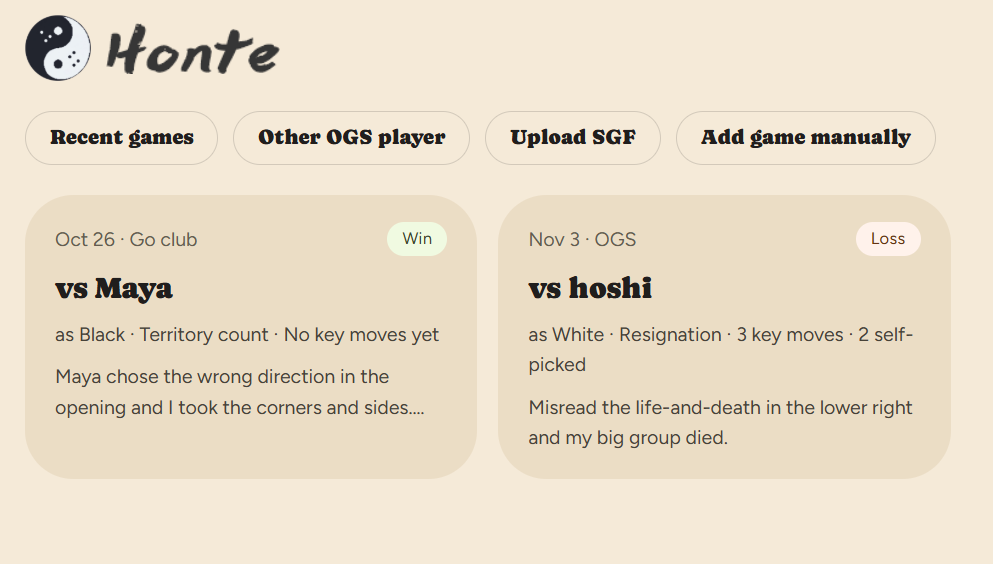
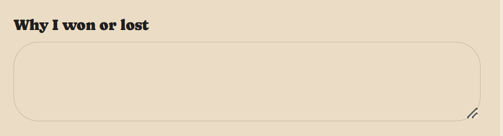
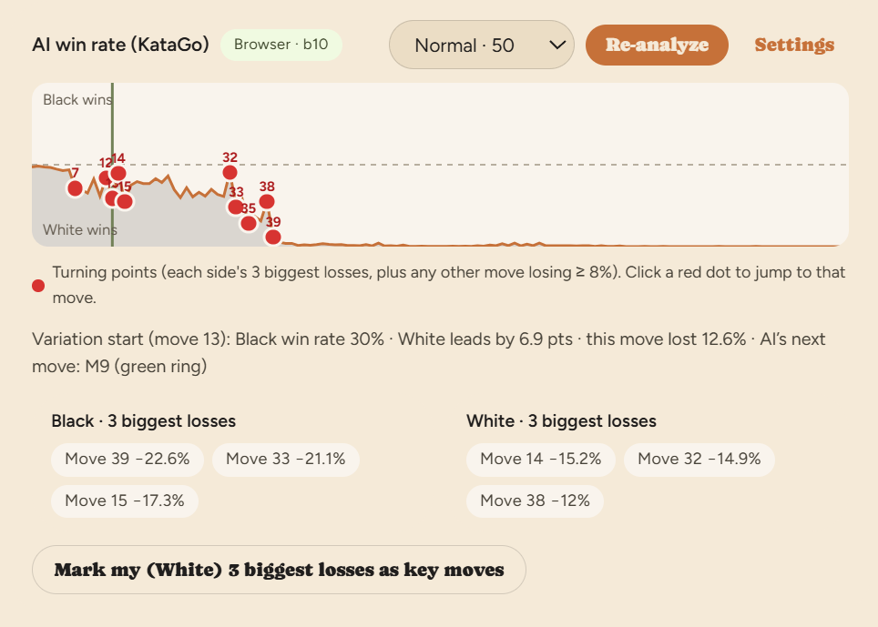
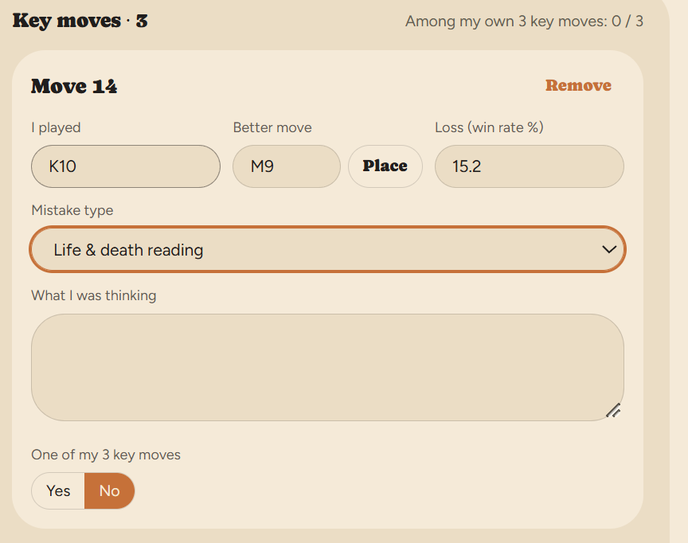
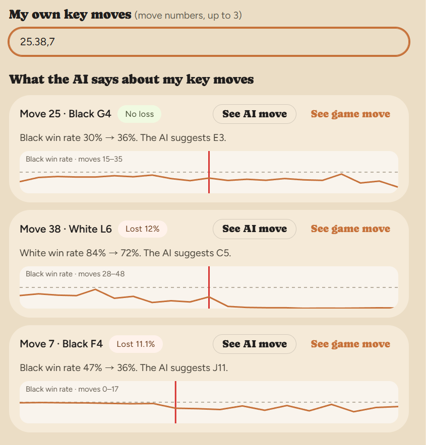
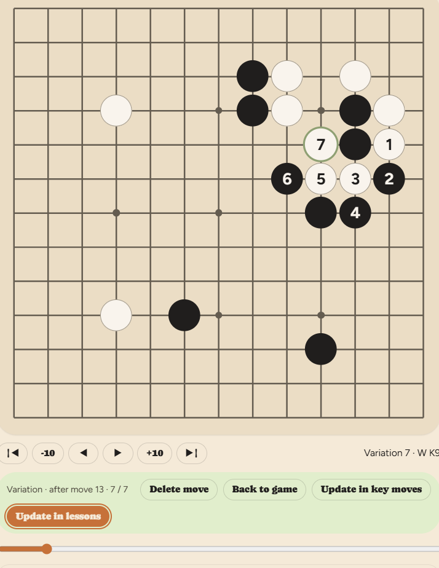
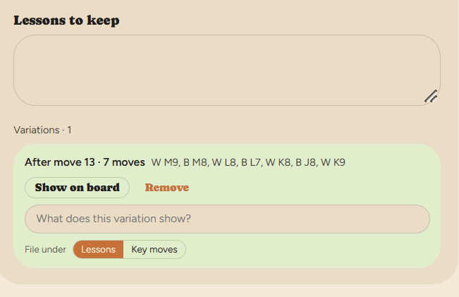

  &nbsp;&nbsp;

<b>Go game review notes for OGS players, with KataGo built in.</b>

  <a href="https://connorxwolf.github.io/honte-review/"><b>Open Honte →</b></a>
  &nbsp;·&nbsp;
  <a href="https://connorxwolf.github.io/honte-review/app.dc.html?demo=1">Try the demo</a>
  &nbsp;·&nbsp;
  <a href="#support-honte">Support Honte</a>

---

## What is Honte?

Honte (本手, *the proper move*) is a place to review your **[OGS (online-go.com)](https://online-go.com)** games and keep what you learn from them.

Pick one of your recent OGS games and write down why you won or lost and which moves you think mattered. Then let **KataGo** show you where the game actually turned. Honte keeps those notes for every game, so the same mistake is easier to spot the next time.

- **No account, no password.** Enter your OGS username, player ID or profile URL and you get a **12-character code**. That code is your login on any device. No OGS account? You can get a code without one.
- **Your OGS games, one click away.** Your latest 20 finished games are listed automatically.
- **KataGo runs in your browser.** Nothing to install, no server, no cost.

---

## Get your code

1. Open Honte. Under **No code yet? Enter your OGS ID**, type your OGS username, player ID (e.g. `123456`) or profile URL (`https://online-go.com/player/123456/`).
2. Press **Get my code**. You receive a code like `XXXX-XXXX-XXXX`, linked to that OGS account.
3. **Save the code.** It's the only way to sign in on another device, and it can't be recovered. Entering your OGS ID again creates a *new, empty* account, so nobody can open your notes just by knowing your OGS name.

**Don't have an OGS account?** Choose **I don't have an OGS account → Get a code without OGS**. You get a code right away and can review SGF files and over-the-board games. If you join OGS later, open **Recent games** and use **Link my OGS account**: your code and notes stay the same.

---

## Pick a game

**Recent games** lists the latest 20 finished games of your linked OGS account, with players, ranks, board size, and your result.

**Other OGS player** lists anyone's latest 20 games. Use it for a friend's game, or a strong player's game you want to study.

You can also **Upload SGF** from any server or program, or **Add game manually** for an over-the-board game. Every reviewed game is kept on your home page.

When you open an OGS game, the opponent, ranks, komi, rules, handicap, time control and result are filled in for you.

---

## The review: you first, then KataGo

Honte is built around one habit: **write your own review before you look at the AI.** Comparing what you thought with what KataGo found is where most of the learning happens.

### 1. Why I won or lost

In a few sentences, say what decided the game, in your own words.

### 2. My own key moves

Before running any analysis, write down the **3 moves you think mattered most** (e.g. `25, 38, 7`).

### 3. Run KataGo and find the 3 biggest drops

Press **Analyze**. KataGo evaluates every move and draws Black's win rate across the whole game. Red dots mark the turning points, and each side's **3 biggest win-rate losses** are listed below the graph.

Press **Mark my 3 biggest losses as key moves**. Honte adds the three moves where *your* win rate dropped the most, with KataGo's suggested move already filled in.

### 4. Key moves: review the moves that cost the most

Each key move gets its own review:

- **I played** / **Better move**: your move and the better one. Press **Place** to put the better move on the board.
- **Loss (win rate %)**: how much the move cost.
- **Mistake type**: life & death reading · capturing race · tesuji / shape · direction / judging size · endgame · missed opponent's idea · time / byo-yomi.
- **What I was thinking**: what you saw (or didn't) when you played it.
- **One of my 3 key moves**: whether you had already picked it yourself in step 2.

Over many games, **Mistake type** shows which kind of mistake keeps costing you, and **One of my 3 key moves** shows how often you spot your own turning points.

### 5. What the AI says about my key moves

Now compare. For each of your own key moves from step 2, Honte shows the win rate before and after, how much it lost (or *No loss*), KataGo's suggested move, and a small win-rate chart around that move. **See AI move** and **See game move** jump the board to either one.

Sometimes the move you worried about was fine and the real mistake was somewhere you didn't look. That's worth knowing.

### 6. Lessons to keep

End with the lessons you want to bring to your next game.

Try variations right on the board: click an empty point and the colors alternate automatically. Save a variation under **Lessons** or **Key moves**, add a note, and replay it later with **Show on board**.

  
  &nbsp;
  

---

## KataGo in Honte

KataGo runs **inside your browser** through [katago-web](https://github.com/JuneKim0712/katago-web). Choose a model in **AI win rate → Settings**:

| Model | Best for |
|---|---|
| **Light b6c96** | Phones and quick checks. Fast, and loads in seconds. |
| **Standard b10** | Most reviews on a computer. The default. |
| **Strong b40c256** | Deep reviews on a desktop with WebGPU (Chrome / Edge). About 170 MB, slow. |
| **Custom model URL** | Any KataGo `.bin.gz` or `.txt.gz` network that allows cross-origin downloads. |

Visits per move range from **Quick · 25** to **Deep · 200**.

Speed tips:

- Chrome or Edge on a computer uses **WebGPU** and is the fastest. Other browsers fall back to WASM.
- On a phone, use **Light b6c96** with **25** visits.
- A 200-move game at 50 visits takes a few minutes on a computer.

Analysis results are saved with the game, so reopening it doesn't re-run KataGo. You can also run KataGo on your own machine instead; see [`katago-server/`](katago-server/README.md).

---

## FAQ

**Do I need an OGS account?**
No. Choose *I don't have an OGS account* to get a code, then upload SGF files or add games by hand. Link an OGS account later from **Recent games** whenever you like.

**Does Honte change anything on OGS?**
No. It only reads public game lists and game records.

**Can I review private games?**
No. Only public OGS games can be read. You can still upload their SGF.

**I lost my code.**
It can't be recovered. Enter your OGS ID again to start a new account.

**Is my code a password?**
Yes, treat it like one. Don't post it or show it in screenshots.

---

## Self-hosting

Honte is a static site (GitHub Pages) with a small Supabase database for accounts and notes.

1. **Supabase.** Create a project, run [`supabase/setup.sql`](supabase/setup.sql) in the SQL Editor, turn **off** *Confirm email* (Authentication → Sign In / Providers → Email), and put the project URL and publishable key in `config.js`.
2. **GitHub Pages.** Settings → Pages → Deploy from branch → `main` / root.
3. **Optional.** If OGS requests get blocked in some browsers, deploy [`supabase/functions/ogs`](supabase/functions/ogs/index.ts) as an Edge Function named `ogs`, with *Verify JWT* off.

KataGo details: [`katago/README.md`](katago/README.md).

| Path | What it is |
|---|---|
| `app.dc.html` | Sign in, get a code from an OGS ID, and the app shell |
| `review.dc.html` | The review: game list, board, variations, KataGo, notes |
| `api.js` | Supabase data layer, OGS connector, demo data |
| `config.js` | Your Supabase URL and publishable key |
| `katago/` | In-browser KataGo engine and models |
| `katago-server/` | Optional self-hosted KataGo server |
| `supabase/` | Database setup and the optional OGS proxy |

---

## Support Honte

Honte is free to use, with no ads and no paid tier. It's built and maintained by one Go player in their spare time.

If it helps your Go, a small tip keeps it running and pays for new features: hosting, better KataGo models, and more ways to review.

  

Not able to tip? Starring this repo, sharing Honte with your Go friends, or [reporting a bug](https://github.com/ConnorXwolf/honte-review/issues) helps just as much.

---

## License

[MIT](LICENSE). Honte is not affiliated with OGS / online-go.com. KataGo by David J. Wu (lightvector); in-browser engine by [katago-web](https://github.com/JuneKim0712/katago-web).

Also from Honte: [本手 · Honte-Benshou](https://github.com/ConnorXwolf/Honte-Benshou), progress tracking for 101Weiqi homework.
